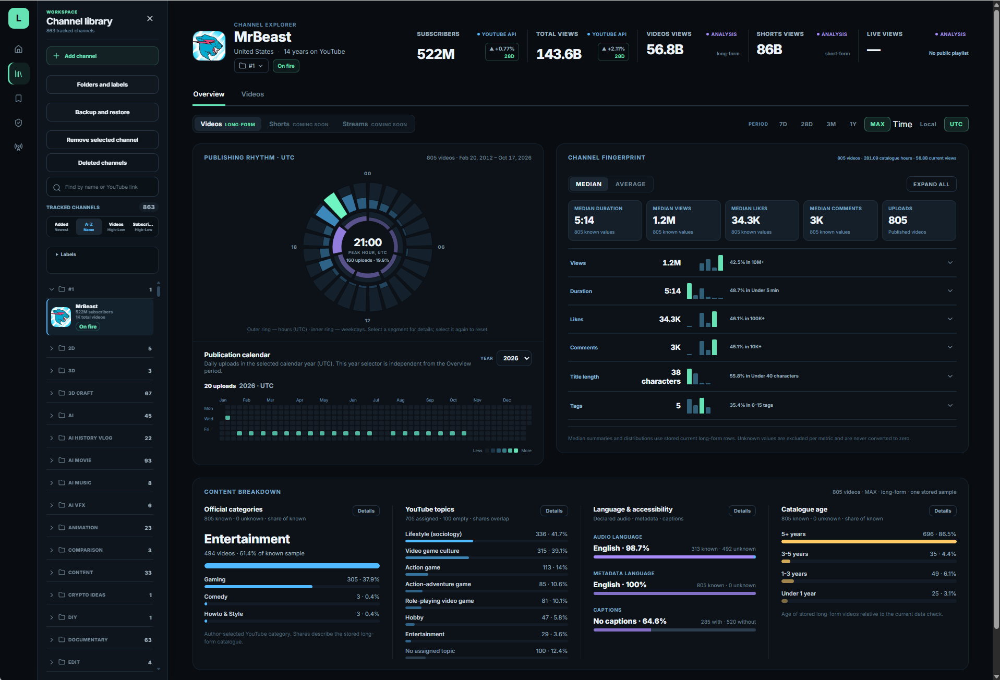

<h1 align="center">Leti Cook</h1>

<h3 align="center">See what's cooking on YouTube.</h3>

  <strong>The open-source, self-hosted YouTube research platform.</strong>

  <a href="#the-ambition">The ambition</a> ·
  <a href="#quick-start">Get started</a> ·
  <a href="#documentation">Documentation</a> ·
  <a href="#help-shape-it">Contribute</a>

The goal is one open platform that connects YouTube discovery, analytics,
monitoring and AI-assisted research in a single workspace.

*The Long-form Channel Explorer in a development installation. Click the image
for the full-size view.*

## Status

**The foundation is already running.** The application collects
Long-form videos, Shorts and Streams, with a working Long-form Explorer, folders,
labels, saved views, video collections and backups of your organized work.

An early version of the [browser extension](extensions/chromium/README.md) lets
you add channels directly from YouTube.

**In active development.** No releases have been published. You can
[run from source](#quick-start). The app is designed for one owner on their own
installation.

**[First steps →](docs/INSTALLATION.md#using-the-workspace)**

## The ambition

Leti Cook aims to bring the useful research capabilities people seek across
**vidIQ, ViewStats, Social Blade, 1of10, TubeBuddy** and other tools into one
open-source platform.

## What it's being built for

These workflows describe the long-term vision for Leti Cook.

- **Understand the channels behind a niche.** Compare publishing frequency,
  video length, format mix and reported statistics across selected channels.
  Explore how these patterns change over time.
- **Find breakouts while they're emerging.** Surface videos gaining unusual
  traction, compare them with similar uploads, and investigate the topics and
  formats that keep appearing among the standouts.
- **Build a library of ideas and packaging.** Compare titles, thumbnails and
  ways of presenting a topic. Collect references, annotate what stands out, and
  develop ideas for your own content.
- **Make every format a full research environment.** Bring discovery, catalogue
  exploration, comparisons, monitoring and AI-assisted investigation to Long-form,
  Shorts and Streams. Move from a single video to a channel or a whole field of
  research, with tools designed around each format.
- **Turn watchlists into useful signals.** Monitor channels, videos and saved
  searches. Get alerts for new uploads, unusual growth and meaningful changes,
  so you can investigate without constantly checking everything yourself.
- **Give an AI agent a research brief.** Describe what you're looking for in
  plain language. Have an agent search and filter your catalogue, organize selected
  videos into collections, and return results with links to the source videos
  and channels.
- **Build research you can reuse and share.** Bring examples, notes and findings
  into connected collections. Export curated work, share it and carry it into
  other tools without rebuilding the same research each time.

## Why I'm building it

I monetized my first YouTube channel in 2013 with video compilations, back before
creators had to worry about yellow dollar signs. Years of creating content gave
me a growing list of questions and a clear picture of the research platform I
wished existed.

For years, I carried that idea around. I knew what I wanted to investigate, what
tools were missing, and how much more useful they could be together. But I had
no programming background. The idea kept growing while my ability to build it
stood still.

In May 2026, I finally started. Working with AI agents made it possible to turn
years of thinking into working software, starting from zero.

Leti Cook is a one-person project with a much bigger ambition: build the research
workspace I've wanted for years, make it open source, and give others the chance
to help shape what it becomes.

## Quick start

Run Leti Cook on your own Linux machine with Docker and your own YouTube Data
API key. The [installation guide](docs/INSTALLATION.md) covers requirements,
setup, access and updates.

Install the [development version from source](docs/INSTALLATION.md#from-source-development).

**[Installation and updates →](docs/INSTALLATION.md)** ·
**[Set up the browser extension →](extensions/chromium/README.md)**

## Your workspace, on your infrastructure

You choose which channels to research. The application and database run on your
own machine.

Your installation works with data from the YouTube API. Please respect
[YouTube's rules](https://developers.google.com/youtube/terms/developer-policies)
when using it. Research features are developed within those rules and the
permissions available to the project.

Your hardware and YouTube API quotas set practical limits.
YouTube's standard rules require the public API data used here to be
refreshed or deleted within **30 days**. Leti Cook uses a **29-day window** and
handles scheduled refreshes and cleanup automatically while running. Expired
data and statistics snapshots older than 29 days are removed. You don't need to
track these deadlines or clean up data manually. The window is measured from
when data was collected, not when a video was published.

Built-in backups preserve the work you organize in Leti Cook.
[Data and backups](docs/DATA.md) explains the details.

## Help shape it

Have a research task that takes too many tools, too much copying, or too much
manual checking? [Describe it in an issue](https://github.com/idontloseiwin/leti-cook-app/issues).
Real workflows help decide what belongs in the platform next.

Try the app, report reproducible bugs, improve the documentation, or contribute
a focused feature. Start with [Contributing](CONTRIBUTING.md). Keep API keys,
private logs and personal datasets out of public issues; use
[Security](SECURITY.md#reporting-a-vulnerability) for sensitive reports.

## Documentation

| What you need | Read |
| --- | --- |
| Install, get started or update | [Installation](docs/INSTALLATION.md) |
| Change collection settings or your API key | [Configuration](docs/CONFIGURATION.md) |
| Understand storage, deletion and backups | [Data and backups](docs/DATA.md) |
| Resolve a problem | [Troubleshooting](docs/TROUBLESHOOTING.md) |

## License

Leti Cook is licensed under [AGPL-3.0-or-later](LICENSE). See [NOTICE](NOTICE) and
the [third-party notices](THIRD_PARTY_NOTICES.md).

Leti Cook is an independent project and is not affiliated with or endorsed by
YouTube or Google. Use of the YouTube API is subject to the
[YouTube API Services Terms of Service](https://developers.google.com/youtube/terms/api-services-terms-of-service).
The software license does not cover YouTube content or third-party trademarks.
